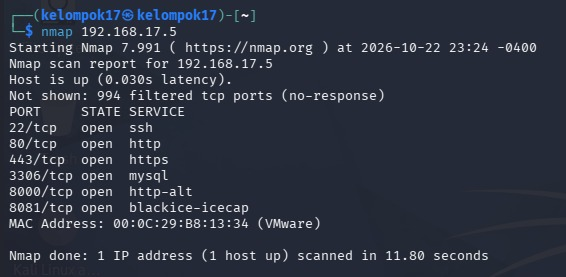
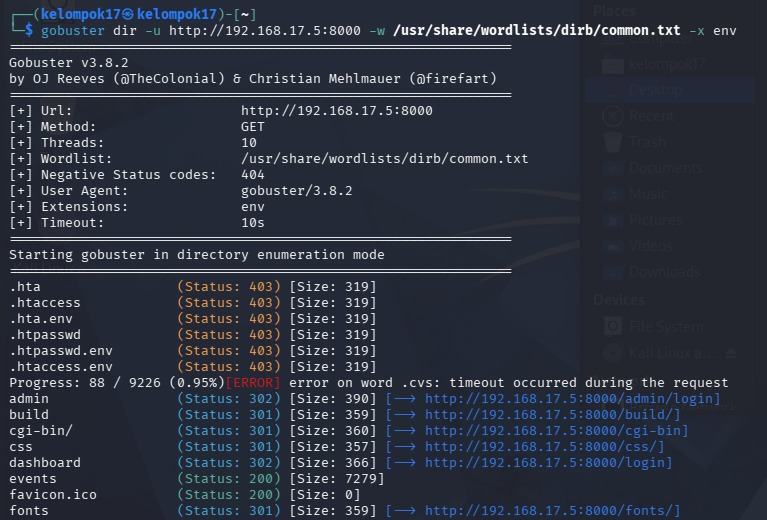
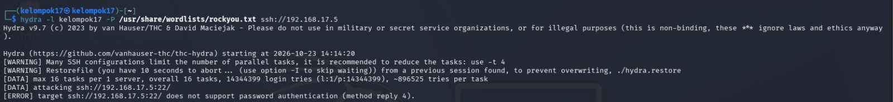

# Red Team Attack Plan Fase 2 (Kelompok 17)

Rencana pengujian penetrasi dan simulasi serangan Red Team menyasar Target Node replika (`192.168.17.5`).

## Skenario 1: Reconnaissance & Enumeration
- **Kategori:** Reconnaissance
- **Tools Utama:** `nmap`, `gobuster`
- **Target Node:** Nginx Web Server (`192.168.17.5:80/443`)
- **Detail Eksekusi:** Melakukan pemindaian port terbuka (22, 80, 443, 1883) dan pemindaian direktori tersembunyi untuk menemukan kebocoran file sensitif (seperti `.env`).
- **Ekspektasi:** Terdeteksi oleh Suricata NIDS di Security Onion.
- **Bukti Eksekusi:**
   
  **Hasil Nmap:**
  
   
  **Hasil Gobuster:**
  

## Skenario 2: SSH Credential Brute-Force
- **Kategori:** Exploitation / Akses
- **Tools Utama:** `hydra`
- **Target Node:** OpenSSH Service (`192.168.17.5:22`)
- **Detail Eksekusi:** Menguji ketahanan autentikasi SSH pada konfigurasi Fase 1 menggunakan daftar kata sandi umum (*wordlist*).
- **Ekspektasi:** Memicu alert login gagal di Security Onion (`auth.log`) dan terblokir oleh `Fail2ban` pada Fase 2.
- **Bukti Eksekusi:**
   
  **Hasil Hydra Brute-Force:**
  

## Skenario 3: Web Vulnerability Scanning
- **Kategori:** Web / Exploitation
- **Tools Utama:** `nikto`, `whatweb`
- **Target Node:** Nginx Web Server (`192.168.17.5:80/443`)
- **Detail Eksekusi:** Scan kerentanan umum web server (misconfiguration, outdated software, exposed headers, default files) pakai nikto, lalu fingerprint teknologi yang dipakai (whatweb) untuk tahu apakah ada CMS/framework tersembunyi.
- **Ekspektasi:** Temuan berupa info disclosure (versi server, header yang bocor) atau kalau beruntung, file/endpoint yang belum di-filter.
- **Bukti Eksekusi:** 
   
  **Hasil WhatWeb:**
  
   
  **Hasil Nikto:**
  
   
  **Hasil cURL env:**
  
